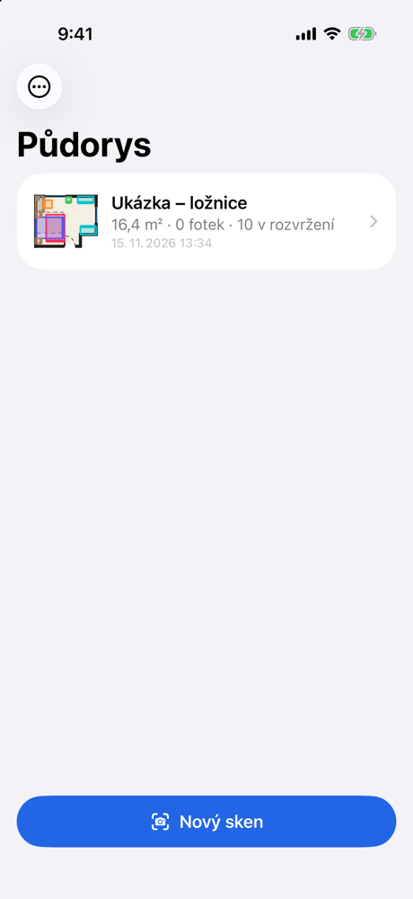
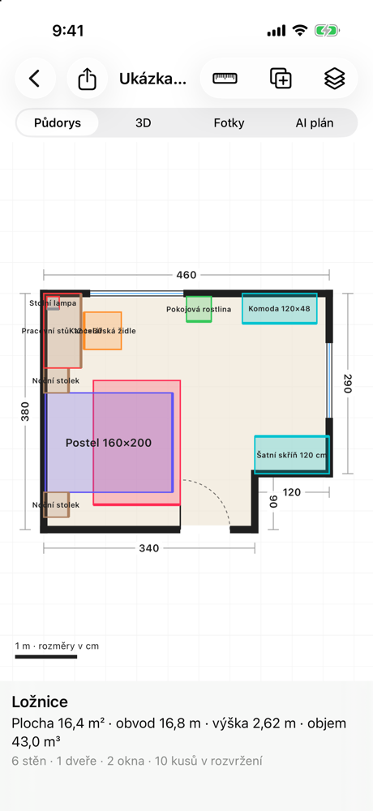
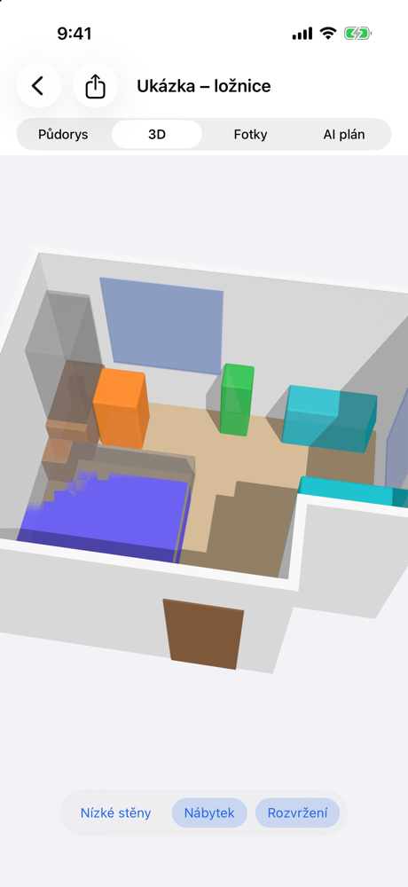
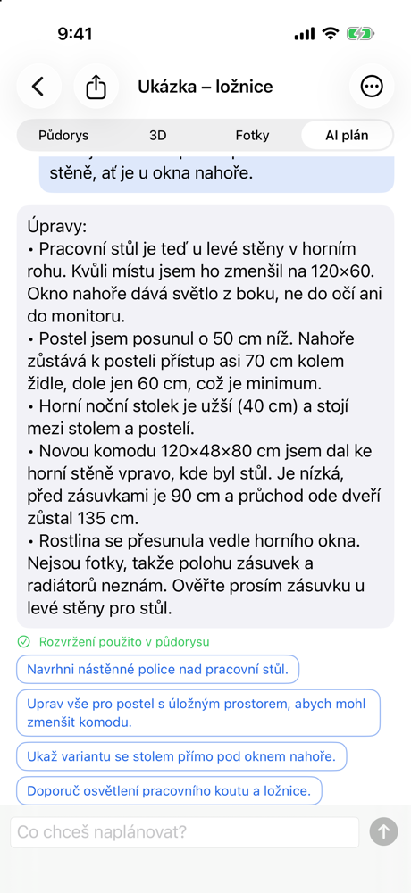

# Půdorys

[](https://github.com/vojtechzicha/pudorys/actions/workflows/build.yml)
[](LICENSE)


An iPhone app that scans a room with LiDAR and turns it into a floor plan with dimensions, a 3D model and a furniture layout you can plan with Claude.

*Půdorys* is Czech for "floor plan". The app's interface is in Czech; the code and docs are in English.

| Scans | Floor plan | 3D | Planning with Claude |
|---|---|---|---|
|  |  |  |  |

The screenshots show the built-in sample room. The layout in them is a real proposal from Claude.

## Features

- **Guided scan.** Apple's [RoomPlan](https://developer.apple.com/documentation/roomplan) walks you through the room and detects walls, doors, windows, openings and larger furniture. Photos taken during the scan are pinned on the plan where they were taken, with the direction they face.
- **Floor plan with dimensions.** Wall lengths in cm, door swings, windows, area, perimeter, ceiling height and volume. Tap a wall, door or window for its size (window sill height included). A ruler measures between any two points and snaps to corners.
- **Furniture layout.** Add pieces from presets or take over what the scan found, then drag, rotate (two fingers or buttons) and resize them. Pieces that stick outside the room, overlap each other or block a door turn red.
- **3D view.** The room with your layout, which you can orbit, plus a low-walls mode for a doll-house view. The scanned model also opens in AR Quick Look.
- **Planning with Claude.** A chat in which Claude gets the measured plan, a picture of it and up to 8 photos, and answers with a complete layout. The layout appears at once in the plan and in 3D, you adjust it by hand, and the next message includes your changes. Each proposal can be undone.
- **Export.** One ZIP with the plan as PDF (A4), PNG and SVG, `plan.json` and `layout.json`, both 3D models (as scanned, and with the planned furniture) as USDZ, RoomPlan's raw data and the photos. See [`examples/demo-bedroom`](examples/demo-bedroom) for what an export contains.

## Requirements

- An iPhone or iPad with LiDAR (Pro models from iPhone 12 Pro on) and iOS 17 or later. Other devices and the Simulator can open the sample room (⋯ → Ukázková místnost) and try everything except scanning.
- Xcode 16 or later and [XcodeGen](https://github.com/yonaskolb/XcodeGen) to build.
- For planning inside the app, an [Anthropic API key](https://platform.claude.com/). Without one, you can still copy the brief to claude.ai or Claude Code and import the answer (see below).

## Build and run

```sh
brew install xcodegen
git clone https://github.com/vojtechzicha/pudorys.git && cd pudorys
xcodegen generate
open Pudorys.xcodeproj
```

In `project.yml`, set `DEVELOPMENT_TEAM` to your Apple team ID (and change `bundleIdPrefix` if you like). Then connect the iPhone, pick it as the run destination and press Run. On first install the iPhone asks you to enable Developer Mode (Settings → Privacy & Security).

## Planning with Claude

**In the app.** Open a room → AI plán → ⋯ → API klíč, paste the key (it is stored in the iPhone's Keychain), and describe what you want, for example "a bedroom with a small home office, keep the bed". The app uses `claude-opus-5-5` with structured JSON output, so every answer is a valid layout. A proposal takes about a minute; with photos, it usually costs a few cents.

**Without an API key, via claude.ai or Claude Code:**

1. AI plán → ⋯ → "Kopírovat zadání pro Clauda" copies the brief (plan JSON and instructions) to paste into claude.ai. Or export the ZIP, move it to a Mac and ask Claude Code in this repository to plan the room. [CLAUDE.md](CLAUDE.md) tells it how.
2. Save the answer as a `.json` file, get it onto the iPhone (AirDrop, iCloud Drive), then AI plán → ⋯ → "Importovat rozvržení".

The plan and layout format is in [docs/layout-format.md](docs/layout-format.md). `python3 tools/check_layout.py <export folder> [layout.json]` checks a layout with the same rules as the app and writes an SVG preview (Python 3 standard library only).

## Privacy

Scans, photos and layouts stay on the device, in the app's Documents folder (visible in the Files app under On My iPhone → Půdorys). The app has no server, analytics or tracking. Data leaves the phone only when you:

- send a planning request: the floor plan, a picture of it, up to 8 photos and your messages go to the [Anthropic API](https://www.anthropic.com/legal/privacy) with your own key;
- share an export or copy the brief yourself.

## Project structure

| Path | What |
|---|---|
| `Pudorys/Scan/ScanView.swift` | RoomPlan capture view, photos with camera pose, saving a scan |
| `Pudorys/Model/PlanBuilder.swift` | RoomPlan `CapturedRoom` → flat `PlanModel` (rotated so the longest wall is horizontal, origin at the room's corner) |
| `Pudorys/Model/` | Plan geometry, layout items and collision rules, furniture presets, storage, sample room |
| `Pudorys/Views/PlanDrawing.swift`, `PlanView.swift` | Plan drawing (shared with the PNG/PDF export) and the interactive plan |
| `Pudorys/Views/Room3DView.swift` | SceneKit model built from the plan |
| `Pudorys/AI/ClaudeClient.swift`, `Views/PlannerView.swift` | Claude Messages API over HTTPS with structured output; the chat |
| `Pudorys/Export/` | `plan.json` brief and the SVG/PDF/PNG/USDZ/ZIP export |
| `tools/check_layout.py` | Layout check and SVG preview outside the app |
| `examples/demo-bedroom/` | Export of the sample room with a layout from Claude |

## Development

The Xcode project is generated from `project.yml`; don't commit `Pudorys.xcodeproj`. Launch arguments help with checks in the Simulator:

| Argument | Effect |
|---|---|
| `-demo` | Open the sample room |
| `-demoLayout` | Give the sample room a sample layout |
| `-tab plan\|model\|photos\|ai` | Start on that tab |
| `-exportTest` | Write an export and print its path |
| `-aiTest "<request>"` | Send one planning request and print `AITEST …` |

Debug builds also read the API key from the `ANTHROPIC_API_KEY` environment variable, so a test can take it from a password manager without storing it:

```sh
xcrun simctl launch booted name.zicha.pudorys -demo -tab plan
SIMCTL_CHILD_ANTHROPIC_API_KEY="$(op read 'op://<vault>/<item>/credential')" \
  xcrun simctl launch --console-pty booted name.zicha.pudorys -demo -tab ai -aiTest "Navrhni rozmístění nábytku."
```

Contributions are welcome; see [CONTRIBUTING.md](CONTRIBUTING.md).

## Limitations

- One room per scan. RoomPlan can merge several rooms into a whole flat (`StructureBuilder`); that isn't wired up yet.
- RoomPlan dimensions are usually accurate to a few centimetres. Measure critical spots (a kitchen run, a built-in wardrobe) with a tape measure.
- RoomPlan detects only larger furniture (beds, sofas, tables, chairs, storage, appliances). Radiators and sockets aren't detected; a photo with a caption tells Claude about them.

## License

[MIT](LICENSE) © 2026 Vojtěch Zicha
